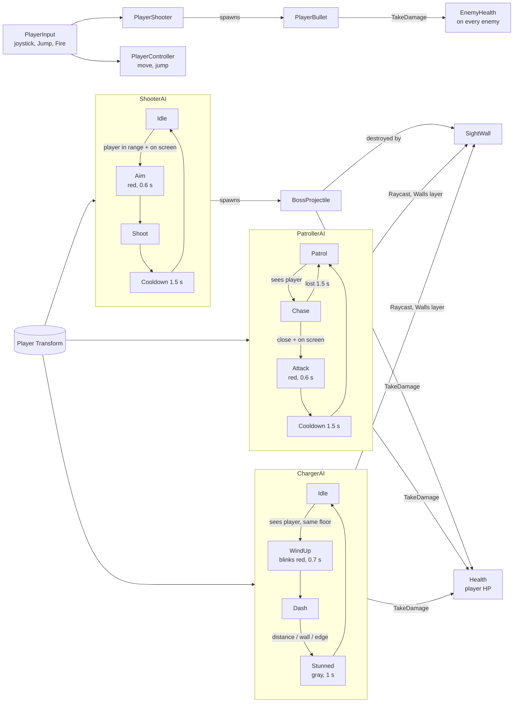

# Script map — Assignment 10 (Level2)

| Script | Job | Talks to |
|---|---|---|
| PatrollerAI | Patrol → Chase → Attack → Cooldown. Sight: distance, angle, Raycast | Player Transform, Health, Walls layer |
| ShooterAI | Idle → Aim → Shoot → Cooldown. Keeps its place, shoots | Player Transform, BossProjectile |
| ChargerAI | Idle → WindUp → Dash → Stunned. Dashes left/right | Player Transform, Health, Walls layer |
| BossProjectile | Flies, hurts the player, stops at Ground and Walls | Health |
| EnemyHealth | HP of an enemy, white flash, destroy at 0 | (called by PlayerBullet) |
| PlayerBullet | Player's bullet | BossHealth, EnemyHealth |
