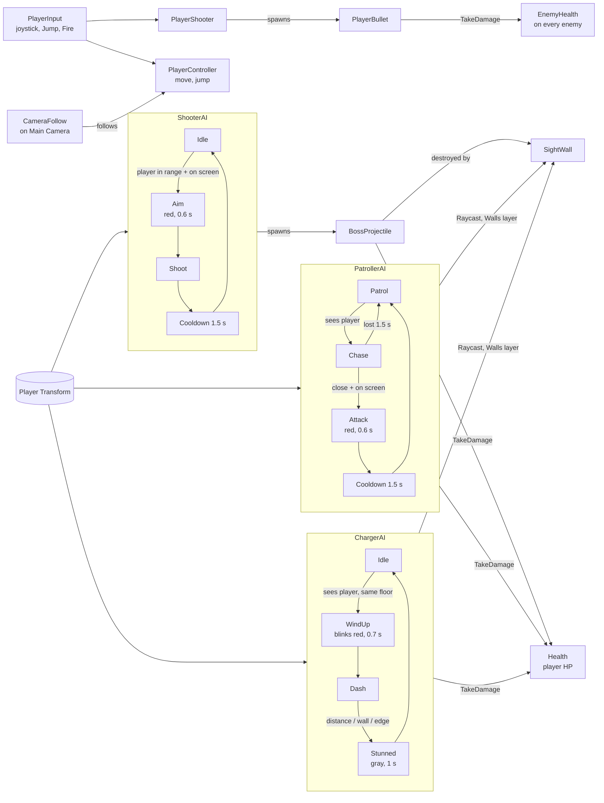
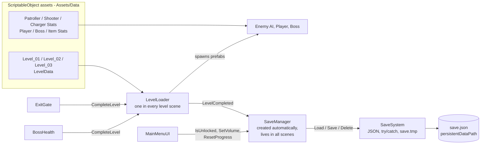
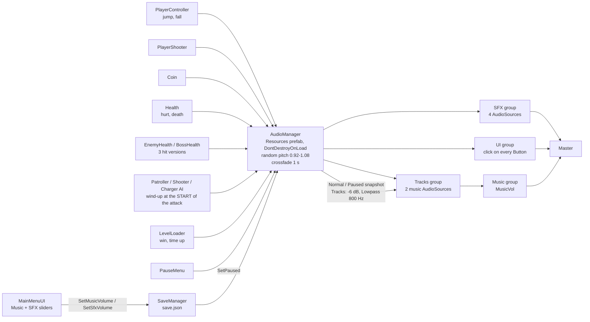

# Script map — Assignment 10 (Level2)

| Script | Job | Talks to |
|---|---|---|
| PatrollerAI | Patrol → Chase → Attack → Cooldown. Sight: distance, angle, Raycast | Player Transform, Health, Walls layer |
| ShooterAI | Idle → Aim → Shoot → Cooldown. Keeps its place, shoots | Player Transform, BossProjectile |
| ChargerAI | Idle → WindUp → Dash → Stunned. Dashes left/right | Player Transform, Health, Walls layer |
| BossProjectile | Flies, hurts the player, stops at Ground and Walls | Health |
| EnemyHealth | HP of an enemy, white flash, destroy at 0 | (called by PlayerBullet) |
| PlayerBullet | Player's bullet | BossHealth, EnemyHealth |
| CameraFollow | Side-scrolling camera, stops at the level ends | Player Transform |

Level2 from left to right: spike → coin 1 → pit → SightWall + Patroller → pit with a step (coin 2) → platforms (coin 3) → Shooter → pit → heart → Charger → pit with a platform → exit.

# Script map — Assignment 11 (data and saves)

| Script | Job |
|---|---|
| EnemyStats + 3 children, PlayerStats, BossStats, ItemStats | All balance numbers as assets |
| LevelData | One level as data: enemies, coins, time limit, next scene |
| LevelLoader | Builds the level from LevelData, timer, CompleteLevel |
| SaveData | What is in save.json: version, unlocked levels, best times, volume |
| SaveSystem | Read/write JSON, safe loading, temp file |
| SaveManager | Save in memory; saves after a level, on pause and on quit |
| MainMenuUI | Level select (locked/unlocked), volume, reset with confirm |

# Script map — Assignment 12 (sound)

| Script | Job |
|---|---|
| AudioManager | Every sound in the game: SFX with random pitch, UI click, music crossfade, pause snapshot, volume in dB |
| MainMenuUI | Music and SFX sliders, read and write the save |
| SaveManager / SaveData | musicVolume and sfxVolume in save.json, applied at launch |
| PauseMenu | Calls SetPaused(true/false) |
| Gameplay scripts | Only call AudioManager.Instance.PlaySfx / PlayRandom / PlayDeath / PlayWin / PlayLose |

Why the slider is on **Music** and the pause effect on its child **Tracks**: after `SetFloat("MusicVol")` the script owns that volume and a snapshot cannot move it.
